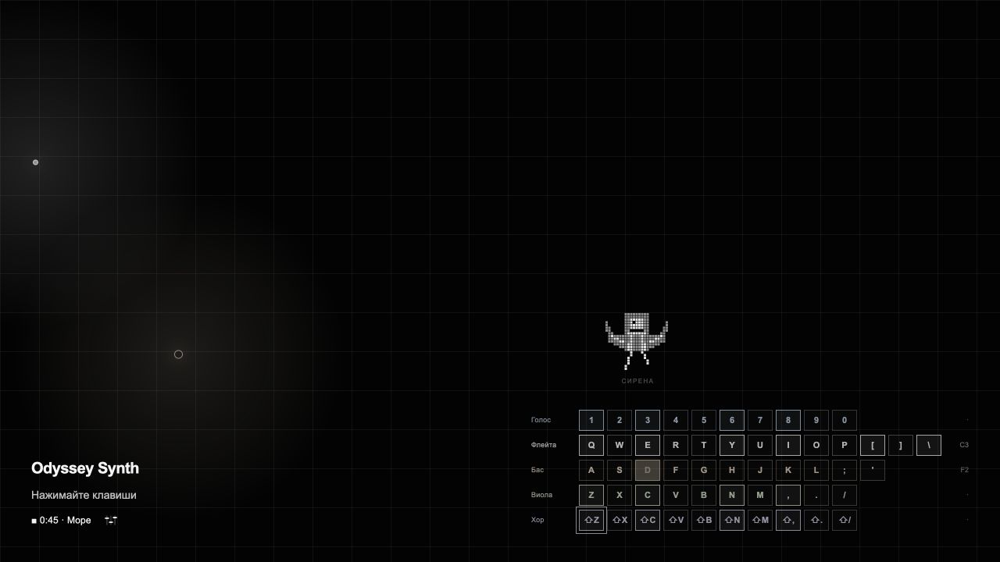

# Odyssey Synth

Минималистичный браузерный музыкальный инструмент по мотивам «Одиссеи» Гомера. Пять синтезированных голосов, десять анимированных пиксельных персонажей и трёхминутное басовое сопровождение «Путь домой» помогают сыграть собственную композицию.

## Ссылка на сайт

[Открыть Odyssey Synth](https://elnuremish.github.io/Odyssey-Synth/)

Сайт работает без сервера приложений, аккаунта и внешних библиотек. Звук включается после первого нажатия. Полная запись, использованная как референс на промежуточном этапе, в проект не входит; финальная версия синтезирует звук средствами Web Audio API.

### Как играть

| Голос | Физические клавиши |
| --- | --- |
| Голос | `1–0` |
| Флейта | `Q–P`, `[`, `]`, `\` |
| Бас | `A–L`, `;`, `'` |
| Виола | `Z–M`, `,`, `.`, `/` |
| Хор | `Shift` + клавиши виолы |

- На поле левая кнопка мыши играет бас, правая — флейту. Горизонтальное движение меняет ноту; вертикальное — яркость флейты.
- Нажатие на название ряда позволяет послушать голос. Подсвеченные клавиши созвучны текущему басу.
- Маленькая кнопка рядом с «Путь домой» открывает громкость каждого голоса.
- `Пробел` запускает или завершает сопровождение; ручная игра басом берёт управление на себя.
- `Esc`, уход из окна и скрытие вкладки прекращают исполнение. Эффекты естественно затихают.
- Персонаж меняется при столкновениях с границами. Нажатие на него меняет персонажа и вызывает тихий музыкальный ответ.
- На сенсорном экране доступны поле и экранные клавиши; отдельный ряд хора не требует аппаратного Shift.

[Партитура «Возвращение на Итаку», 3 минуты](docs/performance.md)

### Локальный запуск

Нужен Node.js 22 или новее. Устанавливать зависимости не требуется.

```sh
npm start
```

Откройте `http://127.0.0.1:4173`. Модульную исходную версию нужно открывать через локальный сервер, а не двойным щелчком по `index.html`.

```sh
npm test
npm run build
```

Команда сборки создаёт `dist/Odyssey.html` — автономный файл со встроенными стилями, кодом и графикой. Его можно открывать напрямую и передавать отдельно. Сборка генерируется из исходников, редактировать её вручную не нужно.

### Структура

| Путь | Назначение |
| --- | --- |
| `index.html` | Основная разметка |
| `src/styles.css` | Единые стили и адаптация под размер окна |
| `src/config.js` | Тембры, ноты и 54 привязки клавиш |
| `src/audio.js` | Синтез, эффекты, микшер и освобождение аудиоузлов |
| `src/score.js` | Шесть глав сопровождения, 80 BPM, 180 секунд |
| `src/traveler.js` | Движение и кадры персонажа |
| `src/characters.js` | Названия персонажей |
| `src/view.js` | Экранная клавиатура, подсветка и микшер |
| `src/app.js` | События клавиатуры и указателя, связь модулей |
| `assets/characters.png` | Один атлас: 10 персонажей × 8 кадров |
| `scripts/` | Локальный сервер и автономная сборка |
| `tests/` | Проверки аудиологики, композиции, клавиш и сборки |

## Скриншот



## Автор

**Агабалаев Эльнур, БДЗ257.**

Я определял идею, визуальный стиль и нужное поведение, оценивал версии инструмента и давал правки. Значительную часть кода, пиксельную графику, тесты и текст документации подготовил Codex по моим запросам. Исходной точкой был переданный мной архив `New Odyssey.zip`, который я создавал до этого в Gemini.
## Что я научился делать

На этом проекте разбираю следующие базовые темы; это не заявление о самостоятельном написании всех перечисленных частей:

- Как HTML, CSS и JavaScript отвечают за структуру, оформление и поведение страницы.
- Как обработчики `keydown`, `keyup` и Pointer Events связывают нажатия со звуком.
- Как Flexbox и медиазапросы помогают разместить клавиатуру на разных экранах.
- Как разделение кода по модулям облегчает поиск и изменение нужного участка.
- Как README, история Git и GitHub Pages помогают оформить и показать проект.

## Использование ИИ

README оформлен по [гайдлайну курса](https://github.com/annkomkova/b26uki). Записи сгруппированы по задачам; неудачные и затем удалённые варианты тоже указаны. Комментарии в исходниках ссылаются на записи ниже.

### Инструменты

| Инструмент | Для чего использовал | Уровень помощи |
| --- | --- | --- |
| Codex / ChatGPT | Идеи, реализация интерфейса и звука, пиксельные анимации, рефакторинг, проверки, README и партитура | 3 |

### Записи о запросах

#### Запись №1 · 30.10.2026 · Первая переработка

- **Что хотел сделать:** развить инструмент из архива `New Odyssey.zip`.
- **Что спросил:** «давай сделай это все. и скинь мне хтмл».
- **Что ответил ИИ:** собрал большой интерфейс с петлями, состояниями звука и дополнительными панелями.
- **Что изменил сам:** отверг перегруженный вариант и потребовал вернуться к исходному минимализму. Самостоятельные правки кода в чате не фиксировались.
- **Как проверялось:** я оценил результат и сообщил, что дизайн слишком далеко ушёл от исходного. Эта версия не входит в финальный проект.

#### Запись №2 · 30.10.2026 · Минимализм и место ноты

- **Что хотел сделать:** сохранить чёрную сетку и добавить понятную обратную связь при игре.
- **Что спросил:** «не меняй кардинально то что имеем, дизайн-код оставь, мысль оставь».
- **Что ответил ИИ:** вернул исходный стиль, привязал свечение к нотам, добавил подсказки созвучных клавиш и удержание баса.
- **Что изменил сам:** уточнил визуальную идею и позже отказался от управления удержанием баса.
- **Как проверялось:** Codex проверял соответствие клавиш нотам, отпускание клавиш и остановку звука при уходе из окна.

#### Запись №3 · 30.10.2026 · Герои и сопровождение

- **Что хотел сделать:** показать именно Одиссея и облегчить исполнение музыкальной фразы.
- **Что спросил:** «не одиссея а одиссей ... пусть он двигается, бьется об углы и меняется».
- **Что ответил ИИ:** сделал пиксельных героев, изменил бас и заменил удержание на простой мотив «Путь домой».
- **Что изменил сам:** исправил понимание персонажа, указал на неудобный бас и непонятную подсказку про пробел.
- **Как проверялось:** Codex проверял смену персонажей, столкновения, запуск сопровождения и перехват баса ручной игрой.

#### Запись №4 · 30.10.2026 · Звуковая запись и дополнительные каналы

- **Что хотел сделать:** разнообразить тембры и различать каналы по клавишам и оттенкам.
- **Что спросил:** «добавь звуки отсюда, более глубокими сделай».
- **Что ответил ИИ:** выделил фрагменты предоставленной записи и сделал на их основе три дополнительных голоса.
- **Что изменил сам:** отверг резкий «Звон» и прямое повторение звуков записи. Эти аудиофрагменты удалены из финального проекта.
- **Как проверялось:** Codex проверял обработку фрагментов, одновременную игру, раскладку и отпускание Shift. Я оценивал звучание и сообщил, что нравится только флейта.

#### Запись №5 · 30.10.2026 · Единое звучание и скрытый микшер

- **Что хотел сделать:** приблизить остальные тембры к флейте и убрать лишние пояснения с экрана.
- **Что спросил:** «единственная крутая вещь — флейта ... такой нужен везде»; затем попросил оставить заголовок, короткую инструкцию и скрытую громкость.
- **Что ответил ИИ:** заменил семплы синтезированными голосами, сохранил флейту и добавил раскрывающийся микшер.
- **Что изменил сам:** выбрал направление звука и минимальный состав текста; дал требования к скрытым регуляторам.
- **Как проверялось:** Codex проверял независимые громкости, совместную игру пяти каналов и отсутствие зависших нот.

#### Запись №6 · 30.10.2026 · Анимации и трёхминутная пьеса

- **Что хотел сделать:** увеличить число персонажей и сыграть законченное высказывание со вступлением, развитием и финалом.
- **Что спросил:** «давай разнообразим персонажей ... хочу ... чтобы они ... были анимированные» и попросил инструкцию на три минуты.
- **Что ответил ИИ:** подготовил десять персонажей с восемью кадрами, шесть глав басового сопровождения и партитуру по времени и клавишам.
- **Что изменил сам:** задал структуру исполнения и необходимость выразительных анимаций.
- **Как проверялось:** Codex проверял кадры, количество событий в главах, автоматическое завершение на 180 секундах и досрочную остановку.

#### Запись №7 · 30.10.2026 · Очистка и публикация

- **Что хотел сделать:** привести накопившийся код в порядок и оформить проект на GitHub.
- **Что спросил:** «очень хорошо разберись с кодом и почисти его от шлака»; передал гайдлайн README.
- **Что ответил ИИ:** разделил код по задачам, объединил стили, заменил пересоздание SVG-пикселей атласом, централизовал аудиоузлы, подготовил тесты, сборку и документацию.
- **Что изменил сам:** подтвердил публичный репозиторий и предоставил имя и группу. Реализацию рефакторинга выполнил Codex.
- **Как проверялось:** `npm test` проверяет аудиологику и освобождение узлов, ограничения голосов, 54 клавиши, структуру композиции и автономную сборку. Эти проверки не оценивают субъективное качество звучания; его нужно оценивать при игре.

### Выводы

ИИ больше всего помог с реализацией звука, анимаций и связью интерфейса с управлением. Не все предложения подошли: первый интерфейс оказался перегруженным, а тембры из записи — неподходящими; я вернул работу к минимализму и выбрал флейту как ориентир. Я задавал художественное направление и оценивал версии, а значительную часть реализации выполнил ИИ. Для защиты проекта мне нужно самостоятельно разобрать модули и уметь объяснить обработку нажатий, создание звука и его остановку.

### Проверка опубликованной версии

После публикации проверены запуск сопровождения, переключение анимированных персонажей, клавиши флейты и хора, открытие микшера и раскладка при ширине 390 пикселей. Ошибок в консоли браузера при этих действиях не обнаружено. Автоматические тесты проверяют аудиологику; оценку тембра на слух они не заменяют.
